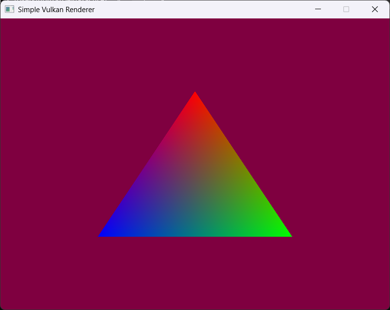

Stage 10

# Command buffers, dynamic rendering, and the first triangle

Video: "Vulkan with C++, Stage 10: Dynamic Rendering", https://www.youtube.com/watch?v=QtBKLnpxzAw
Author's code: `updatedGetIntoGameDev\APIs\vulkan\10 - command buffers\finished`
WebGPU counterpart: the render pass + command encoder + `queue.submit` + `surface.present` loop in `MyLearnWebGPU\MyNotes\HelloTriangle.md` and `TheCommandQueue.md`.



## What this stage does

Records, for each swapchain image, a command buffer that clears the image to dark purple, draws the triangle, and prepares the image for the screen. The render thread then loops: acquire an image, submit its commands, present it. Validation (Debug build): no errors or warnings except GOG Galaxy's three layer-naming warnings from Stage 3. Release build: same picture.

New files: `command.{h,cpp}`, `dynamic_state.{h,cpp}`, `draw.cpp`; `image.cpp` gains layout transitions; `frame.cpp` records commands.

## Vulkan ideas

### 1. Command pools and command buffers
Work for the GPU is **recorded** into a command buffer (`begin`, commands, `end`) and later **submitted** to a queue. Recording costs CPU time and can happen on any thread (that's what makes Stage 13's multithreading possible); submitting is cheap. Buffers are allocated from a **command pool** tied to one queue family. Here each Frame's buffer is recorded once and submitted again every time that image comes up, since the picture never changes. Spec: https://registry.khronos.org/vulkan/specs/latest/html/vkspec.html#commandbuffers

### 2. Dynamic rendering
`beginRendering(renderingInfo)` / `endRendering()` (core in Vulkan 1.3): "draw into these image views, clear them first, keep the result". Before 1.3 you had to create `VkRenderPass` and `VkFramebuffer` objects in advance for every combination of targets. Our attachment: the Frame's image view, load op **clear** (to the clear color), store op **store** (keep the result for presenting). Spec: https://registry.khronos.org/vulkan/specs/latest/html/vkspec.html#renderpass (section "Dynamic Render Pass Instances")

### 3. Image layouts and barriers
A GPU may store an image's pixels differently depending on what it's used for. Each use has a **layout**:
| Layout | Used for |
|---|---|
| `eUndefined` | "I don't care what's in it" (contents may be thrown away) |
| `eColorAttachmentOptimal` | being drawn into |
| `ePresentSrcKHR` | being shown on screen |

Changing layout is done with a **pipeline barrier**, which also orders work:
- **stage masks**: which pipeline stages before the barrier must finish (src) before which stages after it may start (dst). That's the *execution* dependency.
- **access masks**: which memory writes before must be made visible to which reads/writes after. That's the *memory* dependency (flushing and invalidating caches).

Our two barriers per frame:
1. `Undefined -> ColorAttachmentOptimal`: nothing to wait for (top of pipe, no access); color writes wait for it.
2. `ColorAttachmentOptimal -> PresentSrc`: color writes must finish and be visible; nothing later in the buffer waits (bottom of pipe).

Using an image in the wrong layout is undefined behavior: on some GPUs, corrupted pixels. Spec: https://registry.khronos.org/vulkan/specs/latest/html/vkspec.html#synchronization-dependencies · Readable guide: https://docs.vulkan.org/guide/latest/synchronization.html

### 4. All the state shader objects need
With shader objects, nothing about *how* to draw exists until you set it with commands: viewport, scissor, cull mode, front face, polygon mode, sample count/mask, depth/stencil tests, topology, vertex input, blending, color write mask... Drawing with any of them unset breaks the spec. `dynamic_state.cpp` sets all of them in two functions. The author's version misses `setFrontFace` and `setVertexInputEXT` (bug 22); our SDK's validation layer didn't report it (we tested), which is a reminder that the layer is a net, not a proof. Spec list: https://registry.khronos.org/vulkan/specs/latest/html/vkspec.html#shaders-objects-state

### 5. One frame: acquire, submit, present
```
acquireNextImageKHR(swapchain, fence)  -> imageIndex       which image is ours?
waitForFences(fence)                                       ...and really free
submit(frames[imageIndex].commandBuffer)                   draw
queue.waitIdle()                                           wait until drawn
presentKHR(imageIndex)                                     show it
```
This is correct but slow: the CPU waits for the GPU twice per frame, so they never work at the same time. Stage 12 (Synchronization) replaces both waits with **semaphores** (GPU-to-GPU signals), and Stage 14 (Frames in flight) lets the CPU prepare the next frame while the GPU draws. The author's Stage 10 doesn't acquire at all and always presents image 0 (bug 23); he fixes it in Stage 12.

The render thread now spends most of its time waiting on the GPU: about 0.7 of a CPU core in our measurement (2.9 s of CPU time in 4 s). With Mailbox there's no v-sync, so it draws as many frames as it can.

### 6. Waiting before teardown
`~Engine` calls `logicalDevice.waitIdle()` before the deletion queue destroys anything, because destroying objects the GPU still uses breaks the spec (bug 29).

## What the video gets wrong

| Claim | Correction |
|---|---|
| Dynamic rendering means you can swap blend mode / depth test on the fly | Two different features. Dynamic rendering replaces render pass / framebuffer objects. Setting blend/depth/cull with commands comes from shader objects (and the extended dynamic state extensions). The "annoying boilerplate" is required by shader objects. |
| The state must be set before you begin rendering | It's checked at the **draw**; it can be set before or after `beginRendering`. |
| The layout transition "doesn't make a big difference" | The wrong layout is undefined behavior; on some GPUs it corrupts the image. |
| The access mask is a finer "pause point" than the stage mask | Stages = execution order; access = memory visibility. Different jobs, not coarse vs fine. |
| The validation errors are "just" about image index 0 | The missing acquire is the one the layer shows; the two missing states (bug 22) also break the spec. |
| Device functions fetched with `vkGetInstanceProcAddr` | Works, through the loader. `vkGetDeviceProcAddr` (our `init(device)`) is the direct path. On a 1.3 device `vkCmdBeginRendering` is core, no KHR extension or dispatcher needed. |

## C++ refresher

### 1. Aggregate initialization of a struct
```cpp
struct LayoutTransition {
    vk::ImageLayout oldLayout, newLayout;
    vk::AccessFlags srcAccess, dstAccess;
    vk::PipelineStageFlags srcStage, dstStage;
};
transition_image_layout(commandBuffer, image, { vk::ImageLayout::eUndefined,
    vk::ImageLayout::eColorAttachmentOptimal, Access::eNone, Access::eColorAttachmentWrite,
    Stage::eTopOfPipe, Stage::eColorAttachmentOutput });
```
A struct with only public members and no constructors can be filled with `{ ... }` in member order. It replaces the author's 8-parameter function (easy to swap two arguments of the same type). C++20 also allows designated initializers: `{ .oldLayout = ..., .newLayout = ... }`. Source: https://en.cppreference.com/w/cpp/language/aggregate_initialization · CG I.23 "Keep the number of function arguments low"

### 2. `using` aliases inside a function
```cpp
using Stage = vk::PipelineStageFlagBits;
Stage::eTopOfPipe   // instead of vk::PipelineStageFlagBits::eTopOfPipe
```
A local alias shortens long names in one scope only. Source: https://en.cppreference.com/w/cpp/language/type_alias

### 3. Discarding a `[[nodiscard]]` result on purpose
```cpp
(void)graphicsQueue.presentKHR(presentInfo);
```
Vulkan-Hpp marks functions whose result matters `[[nodiscard]]`, so ignoring it is a warning (an error in our build). Casting to `void` says "I know, and it's intentional"; the comment says why. Source: https://en.cppreference.com/w/cpp/language/attributes/nodiscard

### 4. `std::numeric_limits`
`std::numeric_limits<std::uint64_t>::max()` is the largest 64-bit unsigned value, used as "no timeout". Clearer than `UINT64_MAX` or `~0ull`. Source: https://en.cppreference.com/w/cpp/types/numeric_limits

### 5. A destructor must not throw
```cpp
Engine::~Engine() {
    try { if (logicalDevice) { logicalDevice.waitIdle(); } }
    catch (const std::exception& error) { Logger::get_logger().print(error.what()); }
}
```
Destructors are `noexcept` by default; an exception escaping one calls `std::terminate`. `waitIdle` can throw (device lost), so we catch. Source: https://en.cppreference.com/w/cpp/language/destructor (section "Exceptions") · CG C.36/E.16

### 6. Splitting a long function
The author's dynamic state function is ~35 lines. Ours is two functions under 25 lines (rasterization state, output state), plus a 2-line function that calls both. Same commands, readable in one screen each.

## What we changed from the author's code

| Author | Ours | Why |
|---|---|---|
| presents image 0, never acquires | acquire with a fence, submit that image's buffer | bug 23 |
| no `setFrontFace`, no `setVertexInputEXT` | both set | bug 22 |
| no wait before teardown | `waitIdle()` in `~Engine` | bug 29 |
| `VK_KHR_dynamic_rendering` + `VK_KHR_synchronization2` extensions and features | Vulkan 1.3 `dynamicRendering` feature only | core in 1.3; sync2 isn't used yet |
| `eAttachmentOptimal` (a synchronization2 layout) | `eColorAttachmentOptimal` (Vulkan 1.0) | valid without sync2 |
| 8-parameter `transition_image_layout` | `LayoutTransition` struct | named fields |
| `renderingInfo` stored in Frame, pointing at another member | built locally while recording | no dangling pointer if a Frame moves |
| present result ignored | `[[nodiscard]]` respected with `(void)` + reason | build treats warnings as errors |
